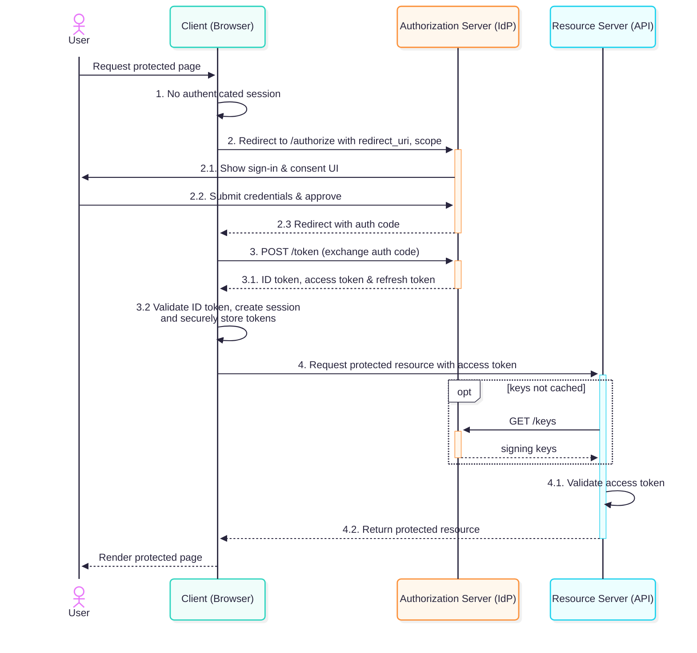
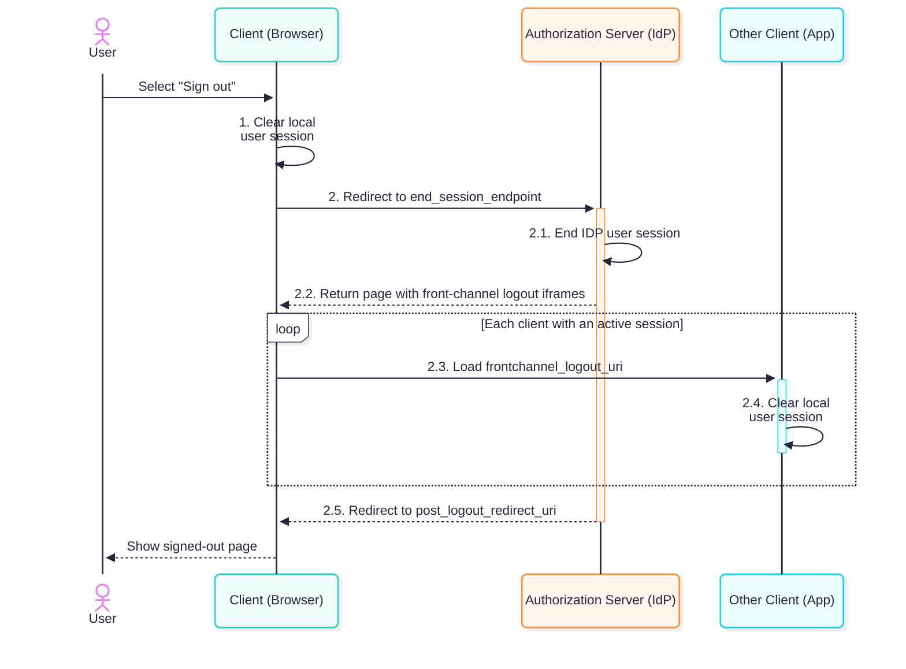
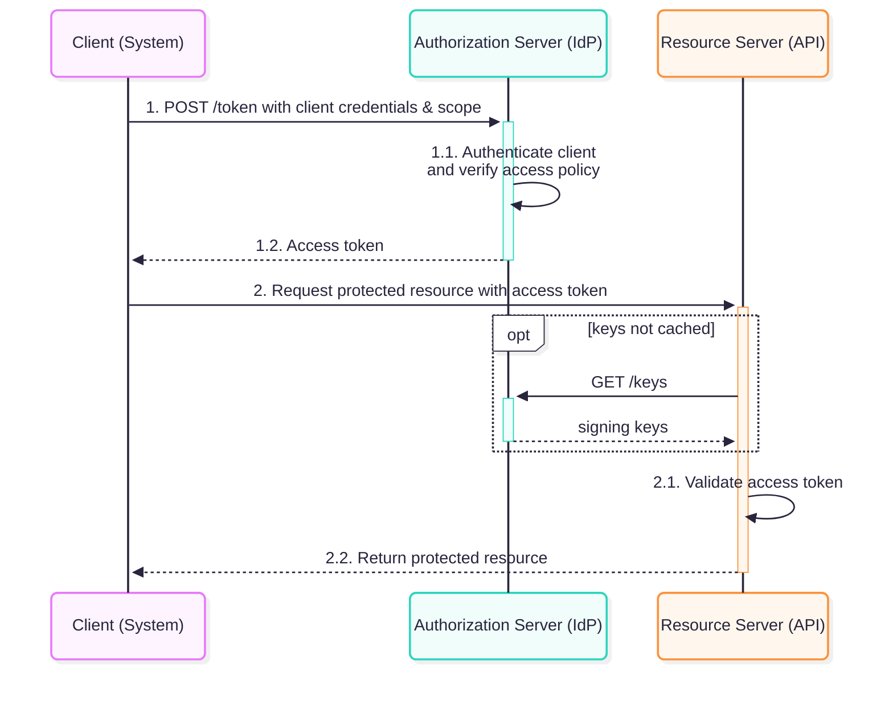

# OAuth and OIDC

[OAuth 2.0](https://en.wikipedia.org/wiki/OAuth) is an authorization framework. It lets an
application obtain access to an API without asking the user to share their password with that
application. [OpenID Connect (OIDC)](<https://en.wikipedia.org/wiki/OpenID#OpenID_Connect_(OIDC)>)
adds an identity layer on top of OAuth 2.0: it lets an application verify who the user is and
receive basic identity information. In enterprise environments, OAuth 2.0 and OIDC are commonly used
for single sign-on, centralized access control, and secure communication between services.

## References

- [RFC-6749](https://www.rfc-editor.org/info/rfc6749/) - The OAuth 2.0 Authorization Framework
- [RFC-9068](https://www.rfc-editor.org/info/rfc9068/) - JWT Profile for OAuth 2.0 Access Tokens
- [RFC-10017](https://www.rfc-editor.org/info/rfc10017/) - OAuth 2.0 for Browser-Based Applications
- [RFC-8252](https://www.rfc-editor.org/info/rfc8252/) - OAuth 2.0 for Native Apps
- [RFC-9700](https://www.rfc-editor.org/info/rfc9700/) - Best Current Practice for OAuth 2.0
  Security
- [OpenID Connect Core 1.0](https://openid.net/specs/openid-connect-core-1_0.html) +
  [more](https://openid.net/developers/specs/) - OIDC Specification

## Participants and responsibilities

| Participant                       | Responsibility                                                                                                                           |
| --------------------------------- | ---------------------------------------------------------------------------------------------------------------------------------------- |
| **User** (resource owner)         | Signs in and, when required, grants an application access to their data.                                                                 |
| **Client**                        | The application requesting tokens. It sends the access token when calling an API.                                                        |
| **Authorization Server** (AS/IdP) | Authenticates users and clients, applies consent and access policies, and issues tokens. It is often part of an identity provider (IdP). |
| **Resource Server** (API)         | The API that protects resources. It validates access tokens and decides whether each request is allowed.                                 |

## Authentication and Authorization flows

### OIDC Sign-In (Authorization Code Flow / ACF)

Use the
[Authorization Code Flow](https://openid.net/specs/openid-connect-core-1_0.html#CodeFlowAuth) to
sign users in to web or native applications, or to authorize those applications to access an API on
their behalf. The browser redirects to the identity provider for sign-in, so the application does
not handle the user's password. The app uses the ID token to establish the user's identity and the
access token to call APIs.



### Prerequisites (ACF)

The application must be [registered as a client](https://www.rfc-editor.org/info/rfc6749/#section-2)
with the authorization server and the API scopes it requires must have been enabled.

### Steps (ACF)

1. The app checks for an existing session when the user requests a protected page. We assume the
   user is not signed in yet.
2. The app starts the sign-in flow by redirecting the browser to the identity provider's
   authorization endpoint with an
   [Authentication Request](https://openid.net/specs/openid-connect-core-1_0.html#AuthRequest):
   - `client_id`: the application's registered identifier at the identity provider.
   - `response_type=code`: selects the Authorization Code Flow.
   - `redirect_uri`: the registered callback URL where the authentication response is sent. It must
     exactly match a URL registered for this client.
   - `scope`: space-delimited list of scopes, e.g., `openid profile email orders:read`. Must include
     `openid` to make this an OIDC request. Include `offline_access` to request a refresh token.
     Other scopes request access for
     [profile claims](https://openid.net/specs/openid-connect-core-1_0.html#ScopeClaims) or APIs.

   Common additional parameters are:
   - `state`: a random value to correlate the authentication request with its callback.
   - `nonce`: a random value to correlate the ID token with its authentication request.
   - `code_challenge`: the [PKCE](https://datatracker.ietf.org/doc/html/rfc7636) challenge derived
     from the private [code_verifier](https://datatracker.ietf.org/doc/html/rfc7636#section-4).
   - `prompt` (optional): can ask the identity provider to show login or consent again.

   For example, the app could redirect the browser to this authorization URL:

   ```text
   https://idp.example.com/authorize?response_type=code&client_id=web-portal&redirect_uri=https%3A%2F%2Fapp.example.com%2Fcallback&scope=openid%20profile%20orders%3Aread&state=RANDOM_STATE&nonce=RANDOM_NONCE&code_challenge=PKCE_CHALLENGE&code_challenge_method=S256
   ```

   2.1. and 2.2. The user
   [signs in at the identity provider](https://openid.net/specs/openid-connect-core-1_0.html#Authenticates),
   which may require MFA and may show a consent screen.

   2.3. The provider returns an
   [Authentication Response](https://openid.net/specs/openid-connect-core-1_0.html#AuthResponse): it
   redirects the browser to the registered callback with a short-lived authorization `code` and the
   original `state`. The app needs to check that the returned state matches the expected value.

3. The app exchanges the `code` at the token endpoint with a
   [Token Request](https://www.rfc-editor.org/info/rfc6749/#section-4.1.3):
   - `grant_type=authorization_code`: selects the Authorization Code flow.
   - `client_id`: the application identifier registered with the identity provider.
   - `client_secret`: the application's secret registered with the identity provider (must not be
     provided if it's a [public client](https://www.rfc-editor.org/info/rfc6749/#section-2.1)).
   - `code`: the authorization code received from the authorization server.
   - `code_verifier`: the private
     [code_verifier](https://datatracker.ietf.org/doc/html/rfc7636#section-4) that was created
     before the authentication request.
   - `redirect_uri`: required, if this parameter was included in the prior authentication request,
     and its value MUST be identical.

   Example request:

   ```bash
   curl -X POST "https://idp.example.com/token" \
   -H "Content-Type: application/x-www-form-urlencoded" \
   -d "grant_type=authorization_code" \
   -d "client_id=web-portal" \
   -d "code=$CODE" \
   -d "code_verifier=$CODE_VERIFIER" \
   -d "redirect_uri=https://app.example.com/callback"
   ```

   3.1. The identity provider checks the `code` and validates the `code_verifier` against the
   `code_challenge`. If all parameters are correct, it sends back a
   [Token Response](https://www.rfc-editor.org/info/rfc6749/#section-4.1.4):
   - `token_type`: the type of the token issued (usually Bearer).
   - `expires_in`: the lifetime in seconds of the access token. For example, the value `3600` means
     that the access token will expire in one hour from the time the response was generated.
   - `access_token`: the access token issued by the authorization server.
   - `refresh_token` (optional): the refresh token, which can be used to obtain new access tokens as
     described in [Refreshing an Access Token](https://www.rfc-editor.org/info/rfc6749/#section-6).
     A refresh token is issued only if the identity provider policy permits it (e.g., only for
     confidential clients).
   - `id_token`: [ID Token](https://openid.net/specs/openid-connect-core-1_0.html#IDToken) value
     associated with the authenticated session.

   Example response:

   ```json
   {
     "token_type": "Bearer",
     "expires_in": 3600,
     "access_token": "2YotnFZFEjr1zCsicMWpAA",
     "refresh_token": "tGzv3JOkF0XG5Qx2TlKWIA",
     "id_token": "KgrNUBcotZ2g1SqGvGFwlQ"
   }
   ```

   3.2. The app
   [validates the ID token](https://openid.net/specs/openid-connect-core-1_0.html#IDTokenValidation)'s
   signature, issuer, audience, expiry, and that its nonce matches the original request. It uses the
   ID token to establish the user's identity, creates its own session, and stores tokens securely.
   The ID token is for the app and must not be sent to the API.

4. The app sends the **access token** when it calls the API:

   ```bash
   curl "$API_BASE_URL/orders" -H "Authorization: Bearer $ACCESS_TOKEN"
   ```

   4.1. The resource server must
   [validate the access token](https://datatracker.ietf.org/doc/html/rfc9068#name-validating-jwt-access-token)
   before using its claims. It needs to check, among other things:
   - that the JWT access token has a valid signature from the authorization server. This proves that
     the claims were signed by a trusted issuer and have not been tampered with.
   - that the `iss` claim matches the issuer URI of the authorization server.
   - that the `aud` claim contains the expected identifier for the API being called. This ensures
     the token was issued for this resource server, not just for the client or another API.
   - that the token has not expired, based on the `exp` and `nbf` claims.
   - that the `scp` claim contains the necessary scopes for the API, e.g., `orders:read`.

   The resource server then applies user-specific rules using `sub` to identify the user, such as
   whether that user may read these orders. It may also check `client_id` if only certain clients
   may call the API.

   4.2. The resource server responds with `200 OK` for a valid token, `401 Unauthorized` for an
   invalid token and `403 Forbidden` when a valid token lacks the required scope or permission.

### Typical JWT token claims (ACF)

Access tokens are [JSON Web Tokens (JWT)](https://www.jwt.io/introduction) in
most deployments, and their claims typically include information about the issuer, user, API,
client, and granted scopes. However, OAuth also allows opaque access tokens, which the resource
server validates through [token introspection](https://www.rfc-editor.org/info/rfc7662/). The exact
JWT claims depend on the provider and token profile.

<!-- prettier-ignore -->
> [!TIP]
> The [jwt.io debugger](https://www.jwt.io/) is useful for inspecting and debugging JWTs.

#### Access token (ACF)

This example for a user access token follows the general shape of an
[RFC-9068 JWT Access Token](https://www.rfc-editor.org/rfc/rfc9068.html#name-jwt-access-token-header-and):

```json
{
  "iss": "https://idp.example.com/",
  "sub": "user-123",
  "aud": "https://api.example.com/",
  "client_id": "web-portal",
  "iat": 1792627200,
  "exp": 1792627800,
  "jti": "token-id-456",
  "scp": "orders:read profile"
}
```

- `iss`: identifies the token issuer.
- `sub`: identifies the user.
- `aud`: identifies the API meant to accept the token.
- `client_id`: identifies the client
- `scp`: lists delegated access. Some token profiles use `scope` for the same information; check the
  provider's documentation. Tokens may also include application-specific claims such as `roles` or
  `groups`.

#### Identity token (ACF)

An [OIDC ID token](https://openid.net/specs/openid-connect-core-1_0.html#IDToken) is also a JWT.
However, it is for the client, not the API:

```json
{
  "iss": "https://idp.example.com/",
  "sub": "user-123",
  "aud": "web-portal",
  "name": "John Doe",
  "email": "john.doe@example.com",
  "preferred_username": "j.doe",
  "iat": 1792627200,
  "exp": 1792627800,
  "nonce": "the-request-nonce"
}
```

- `iss`: identifies the token issuer.
- `sub`: identifies the user.
- `aud`: identifies the app (client) that the user has logged into.
- `name`: End-User's full name in displayable form.
- `email`: End-User's preferred e-mail address.
- `preferred_username`: Shorthand name by which the End-User wishes to be referred to.

It is common, for an ID token to include
[additional claims](https://openid.net/specs/openid-connect-core-1_0.html#StandardClaims) that
provide more information about the user.

### Consent and permissions (ACF)

- **User consent:** The authorization server may ask the user to approve requested access, such as
  `orders:read`. It can issue fewer scopes than the client requested. Consent records the user's
  approval for a client to request access. It does not by itself decide which orders the user may
  read. First-party clients may have consent screens skipped by policy, while third-party clients
  may require explicit consent.
- **User permissions:** Rules such as “Alice may use the admin portal, Bob may not” are application
  authorization policies. The authorization server may put roles or groups into a token, or the API
  may look them up. The resource server must enforce the rule for the requested operation. A valid
  token alone does not imply admin access.
- **Client permissions:** The authorization server can restrict which clients may use a grant,
  request particular scopes, or receive tokens for an API. It can also apply different trust or
  consent policies to first-party and third-party clients. The API can additionally check the
  token's `client_id` when access depends on the calling application.

## OIDC Sign-Out

OIDC defines standard mechanisms for single sign-out. A user can initiate logout from an application
through its UI
(["RP-Initiated Logout"](https://openid.net/specs/openid-connect-rpinitiated-1_0.html)). The
application can then request that the user be logged out at the identity provider. If the provider
and other active applications support a compatible logout mechanism, such as
["Front-Channel Logout"](https://openid.net/specs/openid-connect-frontchannel-1_0.html) or
["Back-Channel Logout"](https://openid.net/specs/openid-connect-backchannel-1_0.html), the provider
notifies them to end their sessions as well.



### Prerequisites (Sign-Out)

The identity provider and each participating application must support the same logout mechanism. The
respective
[frontchannel_logout_uri](https://openid.net/specs/openid-connect-frontchannel-1_0.html#RPLogout) or
[backchannel_logout_uri](https://openid.net/specs/openid-connect-backchannel-1_0.html#BCRegistration)
must be registered with the identity provider for every application that intends to receive logout
notifications.

### Steps (Sign-Out)

1. The user signs out of the app, and the client clears its local session.
2. The client submits an
   [RP-Initiated Logout Request](https://openid.net/specs/openid-connect-rpinitiated-1_0.html#RPLogout)
   to the identity provider's
   [end_session_endpoint](https://openid.net/specs/openid-connect-discovery-1_0.html#ProviderConfig):
   - `id_token_hint`: the ID token previously issued to the client. An indicator of the identity
     that is to be logged out.
   - `post_logout_redirect_uri`: URL to which the browser is redirected after the logout at the
     identity provider has been completed.
   - `state` (optional): a random value generated by the client, used to correlate request and
     callback.

   2.1. The identity provider may ask the user to confirm logout. It must ask for confirmation if
   the request has no `id_token_hint` or the hint does not identify the current session. After
   confirmation, it terminates its session.

   2.2.-2.4. If the identity provider and applications support a shared logout mechanism, the
   provider notifies participating applications with active sessions. In the case of Front-Channel
   Logout, the identity provider renders iframes in the user's browser that point to the
   applications'
   [frontchannel_logout_uris](https://openid.net/specs/openid-connect-frontchannel-1_0.html#RPLogout).
   In the case of Back-Channel Logout, the identity provider sends a direct request to the
   [backchannel_logout_uris](https://openid.net/specs/openid-connect-backchannel-1_0.html#BCRegistration).
   Each notified application should clear the matching local session. This should ensure that the
   user is logged out of all participating applications. However, Front-Channel notifications depend
   on the browser, and the identity provider cannot guarantee that every application processes its
   notification successfully.

   2.5. After sending the logout notifications, the identity provider redirects the browser back to
   the application from which logout was initiated, specifically, to the
   [post_logout_redirect_uri](https://openid.net/specs/openid-connect-rpinitiated-1_0.html#RedirectionAfterLogout)
   that was provided at the start.

## Client Credentials Flow (CCF)

Use the [Client Credentials Flow](https://www.rfc-editor.org/info/rfc6749/#section-4.4) for
machine-to-machine access when no user is involved. A service authenticates as itself and requests
an access token for an API. There is no browser redirect, user sign-in, ID token, or user consent
step. The client must be confidential and keep its credential secure.



### Prerequisites (CCF)

The system must be [registered as a client](https://www.rfc-editor.org/info/rfc6749/#section-2) with
the authorization server and the API scopes it requires must have been enabled.

### Steps (CCF)

1. The system authenticates itself by sending a
   [Token Request](https://www.rfc-editor.org/info/rfc6749/#section-4.4.2) to the token endpoint of
   the authorization server. There are various
   [client authentication methods](https://openid.net/specs/openid-connect-core-1_0.html#ClientAuthentication).
   The following example uses the common `client_secret_basic` method:
   - `client_id`: the application identifier registered with the identity provider, e.g.,
     `reporting-service`.
   - `client_secret`: the application's secret registered with the identity provider.
   - `grant_type=client_credentials`: selects the Client Credentials flow.
   - `scope`: space-delimited list of API scopes that the system wants to have access to, e.g.,
     `reports:read`.

   Example request:

   ```bash
   curl -X POST "https://idp.example.com/token" \
   -u "reporting-service:$CLIENT_SECRET" \
   -H "Content-Type: application/x-www-form-urlencoded" \
   -d "grant_type=client_credentials" \
   -d "scope=reports:read"
   ```

   1.1. The identity provider verifies the provided credentials and checks that the client has
   access to the requested scopes.

   1.2. If all parameters are correct, it sends back a
   [Token Response](https://www.rfc-editor.org/info/rfc6749/#section-4.4.3):
   - `token_type`: the type of the token issued (usually Bearer).
   - `expires_in`: the lifetime in seconds of the access token. For example, the value `3600` means
     that the access token will expire in one hour from the time the response was generated.
   - `access_token`: the access token issued by the authorization server.

   Example response:

   ```json
   {
     "token_type": "Bearer",
     "expires_in": 3600,
     "access_token": "2YotnFZFEjr1zCsicMWpAA"
   }
   ```

2. The system sends the access token when it calls the API:

   ```bash
   curl "$API_BASE_URL/reports" -H "Authorization: Bearer $ACCESS_TOKEN"
   ```

   2.1. The resource server must
   [validate the access token](https://datatracker.ietf.org/doc/html/rfc9068#name-validating-jwt-access-token)
   before using its claims. It needs to check, among other things:
   - that the JWT access token has a valid signature from the authorization server. This proves that
     the claims were signed by a trusted issuer and have not been tampered with.
   - that the `iss` claim matches the issuer URI of the authorization server.
   - that the `aud` claim contains the expected identifier for the API being called. This ensures
     the token was issued for this resource server, not just for the client or another API.
   - that the token has not expired, based on the `exp` and `nbf` claims.
   - that the `scp` claim contains the necessary scopes for the API, e.g., `reports:read`.

     2.2. The resource server responds with `200 OK` for a valid token, `401 Unauthorized` for an
     invalid token and `403 Forbidden` when a valid token lacks the required scope or permission.

### Typical JWT token claims (CCF)

Access tokens are [JSON Web Tokens (JWT)](https://www.jwt.io/introduction) in
most deployments, and their claims typically include information about the issuer, user, API,
client, and granted scopes. However, OAuth also allows opaque access tokens, which the resource
server validates through [token introspection](https://www.rfc-editor.org/info/rfc7662/). The exact
JWT claims depend on the provider and token profile.

<!-- prettier-ignore -->
> [!TIP]
> The [jwt.io debugger](https://www.jwt.io/) is useful for inspecting and debugging JWTs.

#### Access token (CCF)

This example for a client access token follows the general shape of an
[RFC-9068 JWT Access Token](https://www.rfc-editor.org/rfc/rfc9068.html#name-jwt-access-token-header-and):

```json
{
  "iss": "https://idp.example.com/",
  "sub": "reporting-service",
  "aud": "https://api.example.com/",
  "client_id": "reporting-service",
  "iat": 1792627200,
  "exp": 1792627800,
  "jti": "token-id-789",
  "scp": "reports:read"
}
```

- `iss`: identifies the token issuer.
- `sub`: identifies the client for whom the token was issued.
- `aud`: identifies the API meant to accept the token.
- `client_id`: identifies the client for whom the token was issued.
- `scp`: lists the API scopes that the client is authorized for. Some token profiles use `scope` for
  the same information; check the provider's documentation.

Note, in particular, that in a client access token the `sub` claim identifies the client, not an end
user. It cannot be used to make user-specific authorization decisions. If the application needs to
act on behalf of a user, use a delegated flow that represents that user.

If a client is granted broad access to user data, protect these API endpoints with appropriately
restricted scopes and resource-server authorization rules.

### (CCF) Client permissions

There is no user consent or user-specific permission in this grant. The authorization server decides
which APIs and scopes the client is allowed to request based on its registration and
service-to-service policy. A first-party reporting service may be granted `reports:read` scope,
while a third-party client is not.

The resource server should validate the token and enforce the required scope. If its policy
distinguishes clients, it can also check `client_id` or another documented client claim. A client
credential proves which client is calling, not that the caller should automatically be trusted for
every operation.
